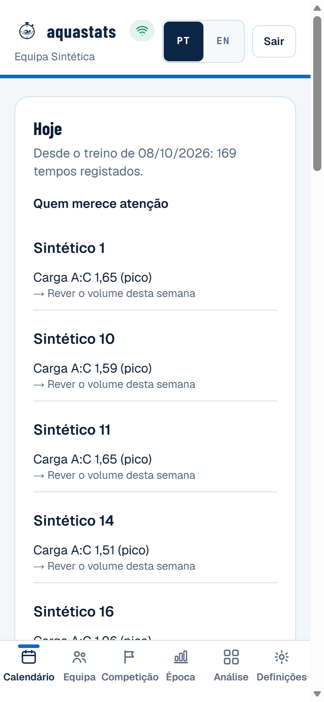
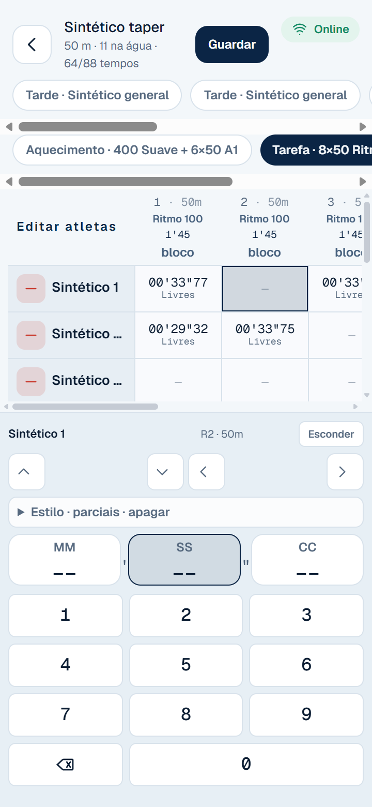
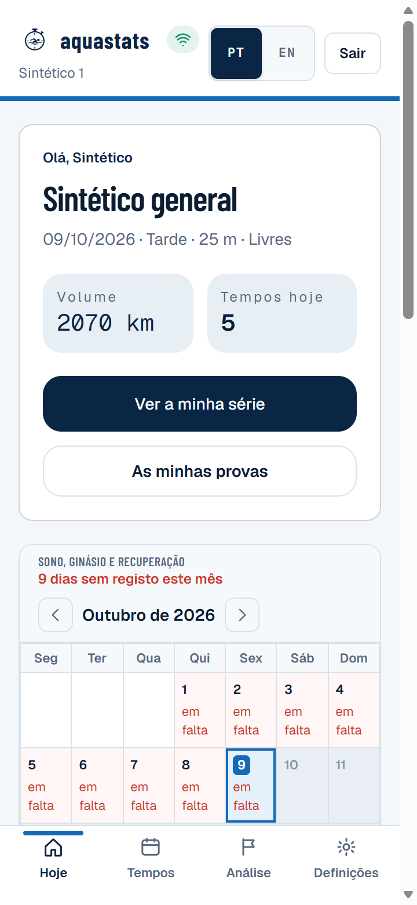
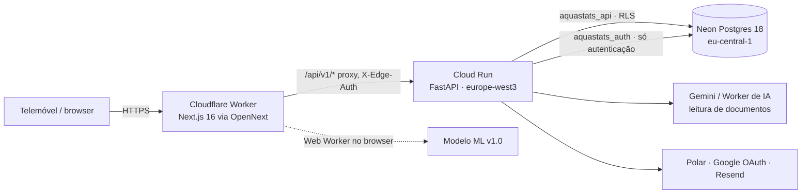

# Aquastats

[](https://github.com/tomascms/aquastats/actions/workflows/ci.yml)

Gestão de uma equipa de natação para o treinador e os atletas: construtor de treinos, cronometragem em matriz
na beira da piscina, competições e análise de prova, época e carga, objetivos, bem-estar, frequência cardíaca,
recordes e um modelo de previsão de tempos. Feito para o telemóvel, em português europeu com inglês completo.

Site: <https://aquastats.net> · Código proprietário, repositório privado ([ADR 0001](docs/adr/0001-licenca-e-autoria.md)).

| Treinador: "quem merece atenção hoje" | Cronometragem | Atleta |
|---|---|---|
|  |  |  |

Capturas de um ambiente local com uma **equipa sintética** (nomes "Sintético N"), nunca dados reais.

## O problema e para quem

Um treinador cronometra dezenas de repetições por treino, com o telemóvel numa mão e o cronómetro na outra, e
depois quer saber quem está em forma, quem está sobrecarregado e o que esperar na próxima prova. Os atletas
querem ver a sua evolução e os objetivos sem expor os dados aos colegas.

## O que faz

- **Treinos e cronometragem:** séries por bloco, grupos, cronometragem tecla a tecla com fila offline; cada
  gravação é idempotente e ordenada pela hora da edição no dispositivo (sem corridas entre dois treinadores).
- **Competições:** inscrições, resultados, ficheiros oficiais (Lenex/PDF, leitura assistida por IA) e
  resultados ao vivo; análise de prova (parciais, frequência, distância por braçada).
- **Época e carga:** macrociclos, carga aguda:crónica (EWMA), simulação de taper.
- **Treinador, "Hoje":** quem merece atenção e porquê (carga, falta de tempos, bem-estar) com a ação sugerida.
- **Atleta:** evolução, objetivos com progresso, recordes, bem-estar, e uma nota clara sobre o que o treinador vê.
- **Modelo de previsão (v1.0, em sombra):** ver abaixo.

## Arquitetura



Detalhe, modelo de dados e decisões: [docs/arquitetura.md](docs/arquitetura.md) e [docs/adr/](docs/adr/).

## Modelo de previsão (resumo honesto)

Modelo de estado hierárquico (v1.0) que prevê o tempo de cada repetição de treino, com intervalos.
**Validado em dados sintéticos, em validação em modo sombra.** Nas sementes de confirmação do gerador erra 0,16
pontos percentuais menos do que o modelo anterior (IC 95 % 0,11–0,21) e prevê 100 % das repetições (o modelo em
produção cobre 24–77 %). A produção ainda não tem tempos reais para o confirmar. Por isso, quando ligado, corre
**em sombra**: grava previsões num ledger imutável, e o treinador continua a ver o modelo anterior. O motor
também estima tempos de prova, mas isso só foi validado em sintético e não aparece na app. A app não mostra
probabilidades de quebra de série nem "saída recomendada".
Ficha completa: [docs/ml/README.md](docs/ml/README.md).

## Segurança e privacidade

- Isolamento na base de dados (RLS) com uma role sem BYPASSRLS para os pedidos de equipa e outra só para a
  autenticação; o atleta só vê os seus dados. Verificado por 49 testes contra Postgres real.
- Apagar um atleta ou uma conta apaga tudo o que lhe pertence, previsões incluídas.
- Sessões HttpOnly/Secure/SameSite, CSRF por origem, argon2id, mensagens de login sem enumeração, rate limit.
- Detalhe e limites conhecidos: [docs/security/](docs/security/). Auditoria própria, não substitui um pentest.

## Desempenho e resiliência (medidos)

Medições locais com uma equipa sintética de 32 atletas × 4 épocas (71 636 tempos), API com a RLS ativa e telemóvel
simulado pelo Lighthouse (4G, CPU 4×). Método, ruído e limites: [docs/release/desempenho.md](docs/release/desempenho.md).

| Medida | Antes | Depois |
|---|---:|---:|
| Matriz de cronometragem: LCP | 21,8 s¹ · 5,6 s² | 3,8 s |
| Matriz de cronometragem: bloqueio do ecrã (TBT) | 10 331 ms¹ · 662 ms² | 40 ms |
| Bytes até a matriz estar pronta | 3,9 MB¹ · 3,2 MB² | 0,4 MB |
| `PUT /times` p95, 20 treinadores com leituras pesadas (`scripts/load_test.py`) | 375 ms² | 121 ms |
| 8 gravações simultâneas da mesma célula | 5 falhavam | 0 falham |

¹ Código original ([diagnóstico](docs/release/fase-a-diagnostico.md)), medido com um conjunto sintético que
incluía uma época futura simulada (mais pesado). ² Código anterior às últimas otimizações, com o conjunto corrigido.

## Correr localmente

```bash
# API (Python 3.12) — usa uma base local; o arranque recusa a base de produção
cd apps/api
python -m venv .venv && .venv/Scripts/pip install -r requirements-dev.txt
cp .env.example .env          # DATABASE_URL de uma base local ou de staging
PYTHONPATH=src .venv/Scripts/uvicorn app.main:app --reload --port 8000

# Dados sintéticos para demonstração
cd ../web && npx tsx scripts/export-synthetic.ts --athletes 30 --seasons 4 --seed 9001 --out ../../.local/synthetic.json
cd ../api && DATABASE_URL=postgresql://postgres@127.0.0.1:5432/aquastats .venv/Scripts/python scripts/seed_synthetic.py ../../.local/synthetic.json

# Site (Next.js 16)
cd ../web && npm ci && npm run dev    # http://localhost:3000
```

## Testes

| Comando | O quê |
|---|---|
| `cd apps/api && pytest` | API; com `TEST_ADMIN_DATABASE_URL` (Postgres local) corre também a suite de RLS, cascatas e corridas |
| `cd apps/web && npm test` | Lógica do site, harness e *golden* do modelo |
| `npx next typegen && npx tsc --noEmit`, `npm run lint` | Tipos e lint |
| `npx tsx scripts/ml-backtest.ts --seeds tune …` | Backtest do modelo (ver [docs/ml/harness.md](docs/ml/harness.md)) |

O CI corre tudo isto com Postgres 18, `pip-audit`, `npm audit` e gitleaks em todo o histórico.

## Deploy e operação

Comandos oficiais (`gcloud`, `wrangler`), reversão, restauro e incidentes: [docs/runbooks.md](docs/runbooks.md).
Plano de produção desta versão: [docs/release/fase-g-plano.md](docs/release/fase-g-plano.md).

## Roadmap

Previsão de provas futuras com intervalo (modelo v1.1), comparação por escalão, resumo semanal, Turnstile no
login, segredos no Secret Manager, CSP com nonces, tarefa agendada para os resultados ao vivo. Avaliar o modelo
desafiante com dados reais logo que haja algumas semanas de tempos cronometrados.
