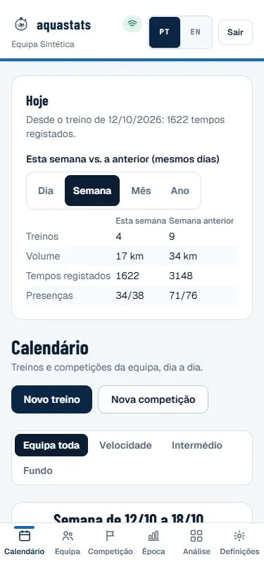
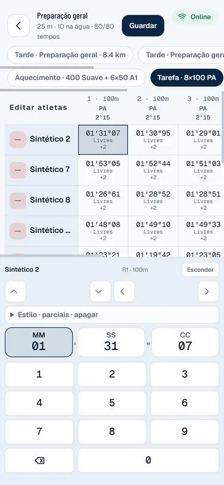
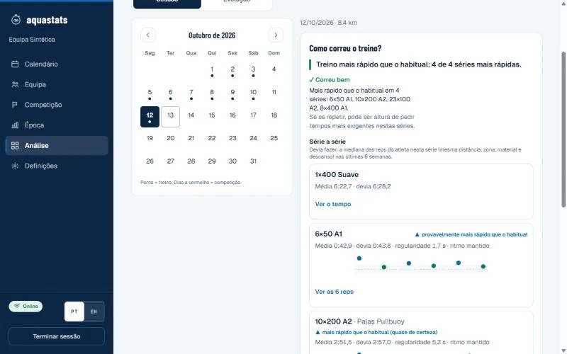
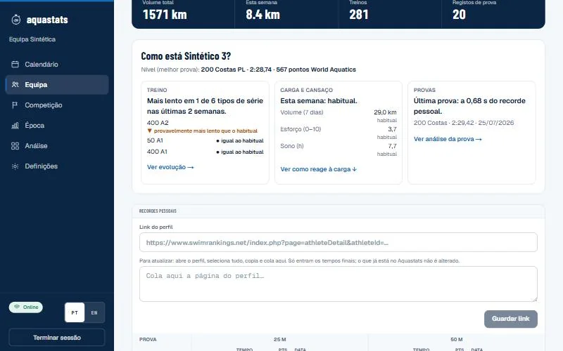
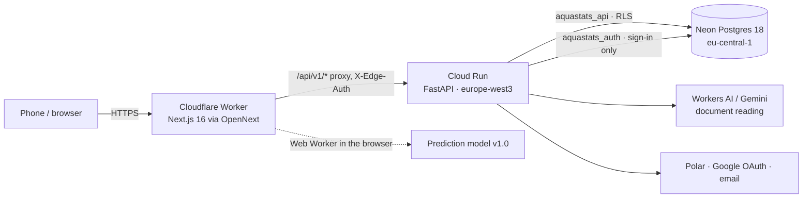

# Aquastats

[](https://github.com/tomascms/aquastats/actions/workflows/ci.yml)
[](https://github.com/tomascms/aquastats/security/code-scanning)
[](LICENSE)
[](https://aquastats.net)

**Poolside timing and training analysis for swimming coaches, in production at [aquastats.net](https://aquastats.net).**
Coaches time every rep on a phone and get one plain answer per screen: how the session went, whether a swimmer is improving, why a race went the way it did.

Designed, built and run by one person. Portuguese UI with a full English translation. Português: [README.pt.md](README.pt.md).

## Screenshots

All screenshots come from a local demo with a **synthetic team** ("Sintético N"), never real swimmers.

<table>
  <tr>
    <td align="center" width="33%"><br><sub>Coach home: the week at a glance</sub></td>
    <td align="center" width="33%"><br><sub>Poolside timing grid, works offline</sub></td>
    <td align="center" width="33%"><br><sub>"How did the session go?"</sub></td>
  </tr>
  <tr>
    <td align="center"><br><sub>"How is this swimmer doing?"</sub></td>
    <td align="center"><br><sub>"Why did the race go this way?"</sub></td>
    <td align="center"><br><sub>The swimmer's own view</sub></td>
  </tr>
</table>

<table>
  <tr>
    <td align="center" width="50%"><br><sub>Training analysis (desktop)</sub></td>
    <td align="center" width="50%"><br><sub>Swimmer profile (desktop)</sub></td>
  </tr>
</table>

## What it does

- **Workouts and timing:** a workout builder (blocks, sets, send-offs, gear, splits) and a timing grid with an
  offline queue. Every save is idempotent and ordered by the device's edit time, so two coaches never overwrite
  each other.
- **Training analysis:** each swimmer is compared with their own typical error (Hopkins, Pyne), certainty is
  stated in words ("probably faster than usual"), and every sentence points to the data behind it.
- **Meets:** entries and results from official files (Lenex or PDF, AI-assisted reading checked value by value
  against the document text), live results, and race analysis against the personal best.
- **Season and load:** macro/mesocycles, zone distribution per phase, weekly load against effort, sleep and times.
- **Swimmers:** their own trend, goals, records and wellness log, written for them; teammates see none of it.

Why each screen looks the way it does, with sources: [docs/natacao/](docs/natacao/benchmark-visualizacao.md).

## Architecture



| Layer | Stack |
|---|---|
| Web | Next.js 16, React 19, TypeScript, Tailwind 4 on Cloudflare Workers (OpenNext) |
| API | FastAPI, Python 3.12, SQLAlchemy, psycopg 3 on Cloud Run |
| Data | Neon Postgres 18 with row-level security, secrets in Secret Manager |
| AI | Cloudflare Workers AI ([`apps/ai-worker`](apps/ai-worker/README.md)) for PDF reading |
| CI | GitHub Actions, CodeQL, gitleaks, pip-audit, npm audit |

Data model, flows and decisions: [docs/arquitetura.md](docs/arquitetura.md) and [docs/adr/](docs/adr/).

## Engineering highlights

Measured locally on a synthetic team (32 swimmers × 4 seasons, 71,636 times) with RLS on and a throttled phone
(Lighthouse, 4G, 4× CPU). Method and noise: [docs/release/desempenho.md](docs/release/desempenho.md).

| What | Before | After |
|---|---:|---:|
| Timing grid, Largest Contentful Paint | 21.8 s | 3.8 s |
| Timing grid, Total Blocking Time | 10,331 ms | 40 ms |
| Bytes until the grid is usable | 3.9 MB | 0.4 MB |
| Opening a swimmer / a session (client navigation) | 1.9 s / 1.0 s | 0.14 s / 0.08 s |
| `PUT /times` p95, 20 coaches with heavy reads | 375 ms | 121 ms |
| 8 concurrent writes to the same cell | 5 failed | 0 failed |

- **Tenant isolation in the database, not only in the UI:** every request sets the user, team and role in the
  transaction and Postgres policies filter the rows; a query without context returns nothing.
- **Offline-first timing:** taps go to a local queue and sync later; versioned writes make retries safe.
- **Heavy work off the main thread:** the prediction model runs in a Web Worker and the coach's data arrives as
  one snapshot, so navigation never waits on the network ([ADR 0003](docs/adr/0003-snapshot-e-modelo-fora-do-main-thread.md)).
- **Decision-first dashboards:** one question per screen, a verdict in words, the number behind it
  ([ADR 0004](docs/adr/0004-dashboards-orientados-a-decisao-do-treinador.md)).

## Security

- Row-level security with two database roles without `BYPASSRLS`: one for team requests, one only for sign-in.
  Checked by 49 tests against a real Postgres (cross-team reads and writes, cascades, races).
- argon2id, HttpOnly/Secure/SameSite sessions, origin-based CSRF checks, rate limits, no account enumeration.
- Strict Content-Security-Policy with a fresh nonce per request (`'strict-dynamic'`, no inline scripts), and
  Cloudflare Turnstile on sign-in and sign-up, verified at the edge.
- The API only accepts traffic from the edge worker (`X-Edge-Auth`); SSRF guards on outbound fetches.
- Deleting a swimmer or an account deletes everything that belongs to them, predictions included.
- gitleaks over the full history, `pip-audit` and `npm audit` on every PR, CodeQL weekly.
- Threat model and known limits: [docs/security/](docs/security/README.md). Self-audited; not a substitute for a pentest.
  Report a vulnerability: [SECURITY.md](.github/SECURITY.md).

## Prediction model, honestly

A hierarchical state model (v1.0, robust Kalman filter) predicts every training rep with an interval.

- Pre-registered, then validated **only on a synthetic generator**: on held-out confirmation seeds its error is
  0.16 percentage points lower than the previous model (95 % CI 0.11–0.21) and it predicts 100 % of reps
  (the model in production covers 24–77 %).
- Production has no timed reps yet to confirm it, so it runs **in shadow mode**: predictions go to an immutable
  ledger and coaches keep seeing the previous model. Race predictions exist in the engine but are not shown.
- Every attempt, including the ones that failed, is logged: [docs/ml/](docs/ml/README.md).

## Repository layout

```
apps/
  web/        Next.js site: coach and swimmer UI, API proxy, prediction model in a Web Worker
  api/        FastAPI: business rules, auth, RLS, official file imports, migrations
  ai-worker/  Cloudflare Worker that reads meet PDFs
docs/         architecture, ADRs, security, runbooks, ML model card, coach logic, release notes
.github/      CI workflow, issue and PR templates, contributing guide, security policy
```

Each app has its own README: [web](apps/web/README.md) · [api](apps/api/README.md) · [ai-worker](apps/ai-worker/README.md).
Documentation index: [docs/README.md](docs/README.md).

## Run it locally (synthetic data only)

You need Python 3.12, Node 20+ and a local Postgres 16+ with `trust` auth. Everything below is local: the API
refuses to start against the production database and the generator only writes made-up data.

```bash
# 1. Local database with the full schema and migrations
cd apps/api
python -m venv .venv && .venv/Scripts/pip install -r requirements-dev.txt
.venv/Scripts/python scripts/build_local_db.py postgresql://postgres@127.0.0.1:5432/postgres aquastats_demo

# 2. Synthetic team: 30 swimmers, 4 seasons, ~70k times and 1,800 races
cd ../web && npm ci
npx tsx scripts/export-synthetic.ts --athletes 30 --seasons 4 --seed 9001 --out ../../.local/synthetic.json
cd ../api && DATABASE_URL=postgresql://postgres@127.0.0.1:5432/aquastats_demo .venv/Scripts/python scripts/seed_synthetic.py ../../.local/synthetic.json

# 3. API (RLS must be on for the aquastats_api and aquastats_auth roles)
DATABASE_ENABLE_RLS=true APP_ENV=development APP_URL=http://127.0.0.1:3000 API_URL=http://127.0.0.1:8000 \
  DATABASE_URL=postgresql://aquastats_api@127.0.0.1:5432/aquastats_demo \
  AUTH_DATABASE_URL=postgresql://aquastats_auth@127.0.0.1:5432/aquastats_demo \
  SESSION_SECRET=local-demo-secret-0123456789abcdef-0123456789 \
  PYTHONPATH=src .venv/Scripts/uvicorn app.main:app --port 8000

# 4. Web
cd ../web && API_URL=http://127.0.0.1:8000 APP_URL=http://127.0.0.1:3000 npm run dev
```

Open `http://127.0.0.1:3000` (not `localhost`) and sign in as `treinador@demo.aquastats.test` (coach) or
`atleta@demo.aquastats.test` (swimmer). The demo password is at the top of
[`apps/api/scripts/seed_synthetic.py`](apps/api/scripts/seed_synthetic.py) and only works on local databases.

## Tests and CI

| Command | Covers |
|---|---|
| `cd apps/api && pytest` | 150+ API tests; with `TEST_ADMIN_DATABASE_URL` also the RLS, cascade and race suite on real Postgres |
| `cd apps/web && npm test` | 120+ logic tests (node:test), the model harness and its golden test |
| `cd apps/web && npm run e2e` | Playwright on a phone viewport against the demo: timing a rep, swimmer summary, race analysis, training report, swimmer view, CSP |
| `npx next typegen && npx tsc --noEmit`, `npm run lint` | Types and lint |
| `npx tsx scripts/ml-backtest.ts --seeds tune …` | Model backtest ([docs/ml/harness.md](docs/ml/harness.md)) |

CI runs all of it on every PR with Postgres 18 (the E2E job builds a synthetic team, starts the API with RLS on
and the production build of the site), plus `pip-audit`, `npm audit`, gitleaks and the production build.

## Deployment and operations

Official CLIs only (`wrangler`, `gcloud`); rollback, restore and incident steps in [docs/runbooks.md](docs/runbooks.md).
Changes per version: [CHANGELOG.md](CHANGELOG.md).

## Licence

Copyright (c) 2026 Tomás Sousa. Proprietary, all rights reserved ([LICENSE](LICENSE)). The code is public to read, not to reuse
([ADR 0001](docs/adr/0001-licenca-e-autoria.md)).
