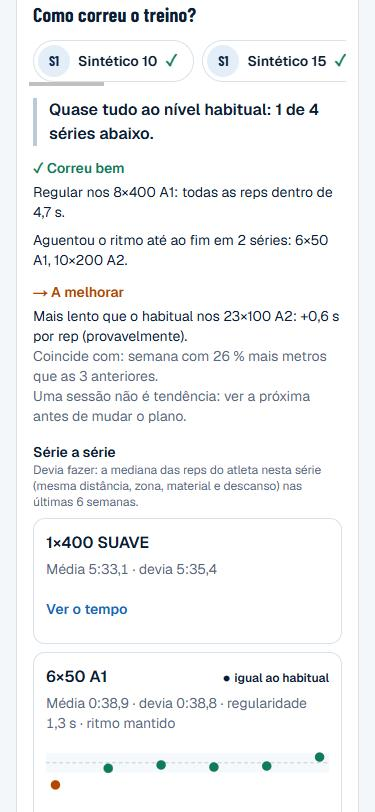
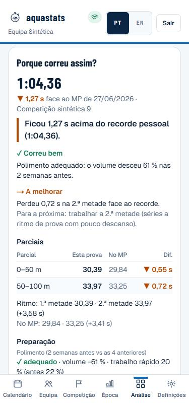
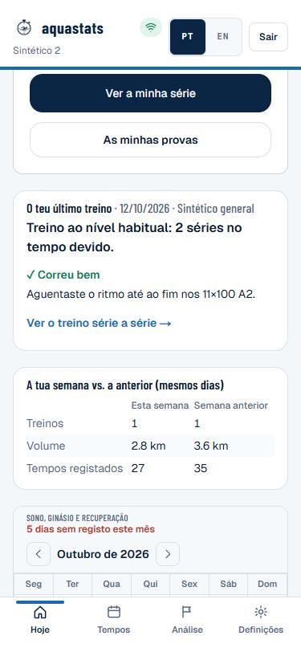
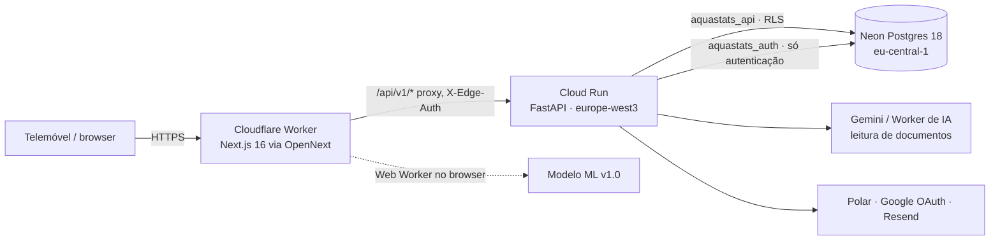

# Aquastats

[](https://github.com/tomascms/aquastats/actions/workflows/ci.yml)

Gestão de uma equipa de natação para o treinador e os atletas: construtor de treinos, cronometragem em matriz
na beira da piscina, competições e análise de prova, época e carga, objetivos, bem-estar, frequência cardíaca,
recordes e um modelo de previsão de tempos. Feito para o telemóvel, em português europeu com inglês completo.

Site: <https://aquastats.net> · [Documentação](docs/README.md) · Código público para consulta, licença proprietária ([ADR 0001](docs/adr/0001-licenca-e-autoria.md)).

| "Como correu o treino?" | Cronometragem | "Porque correu assim?" | Atleta |
|---|---|---|---|
|  |  |  |  |

Capturas de um ambiente local com uma **equipa sintética** (nomes "Sintético N"), nunca dados reais.

## In English

Aquastats is a mobile-first web app for swimming coaches and their swimmers, in production at
<https://aquastats.net> (Portuguese UI with a full English translation). Designed, built and run by one person.

- **Product:** workout builder, poolside timing grid with an offline queue, meets (Lenex/PDF import with
  AI-assisted reading checked against the document text, live results), season planning, and coach-facing
  analysis that answers one question per screen ("How did the session go?", "Is this swimmer improving?",
  "Why did the race go this way?").
- **Analysis grounded in sports science:** each swimmer is compared with their own typical error (Hopkins,
  Pyne), certainty is stated in words, and every sentence points to the data behind it. Research notes and
  sources: [docs/natacao/](docs/natacao/).
- **Stack:** Next.js 16 + React + TypeScript on Cloudflare Workers (OpenNext) · FastAPI (Python 3.12) on Cloud Run ·
  Neon Postgres 18 with row-level security · Cloudflare AI worker · GitHub Actions.
- **Security:** tenant isolation enforced in the database (RLS, two roles without `BYPASSRLS`, 49 tests against
  a real Postgres), argon2id, HttpOnly sessions, origin-based CSRF, rate limits, API origin closed to the edge
  worker. Threat model: [docs/security/](docs/security/).
- **Measured performance:** timing grid LCP 21.8 s → 3.8 s and blocking time 10.3 s → 40 ms on a throttled
  phone; page navigation under 300 ms; idempotent, conflict-free concurrent writes.
- **Prediction model:** a hierarchical state model for every training rep, pre-registered and validated on a
  synthetic generator, running in shadow mode until real data confirms it ([docs/ml/](docs/ml/README.md)).
- **Quality:** pytest (incl. a Postgres suite), node:test, tsc, eslint, `pip-audit`, `npm audit` and gitleaks
  over the full history on every PR. Screenshots and demos use a synthetic team only.

## Estado do projeto

| Parte | Estado |
|---|---|
| Site e API | v1.0.0 em produção (Cloudflare Workers + Cloud Run + Neon) |
| Isolamento de dados | RLS ativa, duas roles sem `BYPASSRLS`, origem da API fechada ao Worker |
| Modelo de previsão | v1.0 em **sombra**: grava previsões, o treinador continua a ver o modelo anterior; validado só em dados sintéticos |
| Testes | API (pytest, incl. suite contra Postgres real) e site (lógica, harness do modelo), tudo no CI |
| Acessibilidade | auditada com axe-core; o que só um leitor de ecrã valida está em [docs/release/acessibilidade.md](docs/release/acessibilidade.md) |

## O problema e para quem

Um treinador cronometra dezenas de repetições por treino, com o telemóvel numa mão e o cronómetro na outra, e
depois quer saber quem está em forma, quem está sobrecarregado e o que esperar na próxima prova. Os atletas
querem ver a sua evolução e os objetivos sem expor os dados aos colegas.

## O que faz

- **Treinos e cronometragem:** séries por bloco, grupos, cronometragem tecla a tecla com fila offline; cada
  gravação é idempotente e ordenada pela hora da edição no dispositivo (sem corridas entre dois treinadores).
- **Competições:** inscrições, resultados, ficheiros oficiais (Lenex/PDF, leitura assistida por IA) e
  resultados ao vivo; análise de prova (parciais, frequência, distância por braçada).
- **Treino — "Como correu o treino?":** uma frase de conclusão, "✓ Correu bem" e "→ A melhorar" com o dado, o
  que coincidiu (sono, ginásio, carga) e uma opção para a próxima; cada série num cartão com média, tempo devido,
  regularidade e reps. Cada atleta é comparado com a sua variação normal, com a certeza em palavras.
- **Evolução — "Está a melhorar?":** por tipo de série, as últimas 2 semanas contra as 6 anteriores.
- **Carga — "Como reage este atleta?":** carga, cansaço (esforço, sono, recuperação) e tempos por semana.
- **Prova — "Porque correu assim?":** tempo e diferença ao recorde pessoal, reação e parciais lado a lado com o
  recorde, ritmo de prova e, para o treinador, polimento e preparação.
- **Época:** macrociclos, distribuição de zonas por fase, simulação de polimento.
- **Atleta:** o último treino e as provas escritos para ele (um ponto forte, um foco), objetivos, recordes,
  bem-estar, e uma nota clara sobre o que o treinador vê.

Porquê assim, com as fontes: [docs/natacao/benchmark-visualizacao.md](docs/natacao/benchmark-visualizacao.md) e
[docs/natacao/guia-do-treinador.md](docs/natacao/guia-do-treinador.md).
- **Modelo de previsão (v1.0, em sombra):** ver abaixo.

## Estrutura do repositório

```
aquastats/
├── apps/
│   ├── web/          Site (Next.js 16): UI do treinador e do atleta, proxy para a API, modelo de previsão
│   ├── api/          API (FastAPI): regras de negócio, autenticação, RLS, importação de ficheiros oficiais
│   └── ai-worker/    Worker de IA (Cloudflare): lê regulamentos e listas em PDF
├── docs/             Arquitetura, decisões (ADR), segurança, runbooks, modelo de ML, histórico da release
├── .github/          CI (testes, auditorias, gitleaks), Dependabot, modelos de issue e PR
├── docker-compose.yml  Serviços locais opcionais (Postgres, Redis)
└── CHANGELOG.md
```

Cada app tem o seu README com a estrutura interna e os comandos: [web](apps/web/README.md) ·
[api](apps/api/README.md) · [ai-worker](apps/ai-worker/README.md). O índice da documentação está em
[docs/README.md](docs/README.md).

## Como funciona, em quatro passos

1. **O treinador monta o treino** no construtor: blocos, séries, repetições, distância, intensidade, tempo de
   saída, material (barbatanas, palas…), estilo, parciais. O treino pode ser escrito em texto para o grupo.
2. **À beira da piscina, cronometra na matriz** (atletas em linhas, repetições em colunas). Cada toque grava
   no telemóvel, entra numa fila offline e sincroniza com a API; duas gravações da mesma célula nunca se
   sobrepõem (ganha a edição mais recente).
3. **A app transforma tempos em conclusões:** como correu cada treino face ao normal de cada atleta, se está a
   melhorar, como reage à carga, recordes, objetivos e análise de prova (parciais, reação, ritmo).
4. **Em competição**, importa inscrições e resultados (Lenex ou PDF, com leitura assistida por IA validada
   contra o texto do documento), segue os resultados ao vivo e compara com a previsão do modelo.

Quem vê o quê é decidido **na base de dados** (RLS por equipa e papel), não só na interface: um atleta só lê
os seus dados e o treinador só lê os da sua equipa.

## Glossário

| Termo | Significado |
|---|---|
| Série / bloco | Conjunto de repetições; um bloco pode repetir-se ("3×") com material diferente por ronda |
| Saída | Tempo de partida de cada repetição (ex.: 1'30" ⇒ parte de 1'30" em 1'30") |
| Parcial (*split*) | Tempo intermédio dentro da repetição ou da prova |
| Piscina curta / longa | 25 m (*scm*) / 50 m (*lcm*): os tempos de uma e de outra não se misturam |
| Intensidade | Suave, A1 a A3, PROG, PA, MAX e ritmos de prova (P50…P400) |
| Erro típico | A variação normal de um atleta na mesma série; uma diferença abaixo dela não é sinal |
| Taper | Redução de volume antes da prova principal |
| Conformal | Método que dá um intervalo com cobertura medida, sem supor a forma do erro |
| RLS | *Row-Level Security*: o Postgres filtra as linhas por equipa e utilizador |

## Arquitetura



**Stack:** Next.js 16 + React (TypeScript) em Cloudflare Workers via OpenNext · FastAPI (Python 3.12) em Cloud Run ·
Neon Postgres 18 com RLS · segredos no Secret Manager · Worker de IA (`apps/ai-worker`) · CI no GitHub Actions.

Detalhe, modelo de dados e decisões: [docs/arquitetura.md](docs/arquitetura.md) e [docs/adr/](docs/adr/).

## Modelo de previsão (resumo honesto)

Modelo de estado hierárquico (v1.0) que prevê o tempo de cada repetição de treino, com intervalos.
**Validado em dados sintéticos, em validação em modo sombra.** Nas sementes de confirmação do gerador erra 0,16
pontos percentuais menos do que o modelo anterior (IC 95 % 0,11–0,21) e prevê 100 % das repetições (o modelo em
produção cobre 24–77 %). A produção ainda não tem tempos reais para o confirmar. Por isso, quando ligado, corre
**em sombra**: grava previsões num ledger imutável, e o treinador continua a ver o modelo anterior. O motor
também estima tempos de prova, mas isso só foi validado em sintético e não aparece na app. A app não mostra
probabilidades de quebra de série nem "saída recomendada".
Ficha completa: [docs/ml/README.md](docs/ml/README.md).

## Segurança e privacidade

- Isolamento na base de dados (RLS) com uma role sem BYPASSRLS para os pedidos de equipa e outra só para a
  autenticação; o atleta só vê os seus dados. Verificado por 49 testes contra Postgres real.
- Apagar um atleta ou uma conta apaga tudo o que lhe pertence, previsões incluídas.
- Sessões HttpOnly/Secure/SameSite, CSRF por origem, argon2id, mensagens de login sem enumeração, rate limit.
- Detalhe e limites conhecidos: [docs/security/](docs/security/). Auditoria própria, não substitui um pentest.

## Desempenho e resiliência (medidos)

Medições locais com uma equipa sintética de 32 atletas × 4 épocas (71 636 tempos), API com a RLS ativa e telemóvel
simulado pelo Lighthouse (4G, CPU 4×). Método, ruído e limites: [docs/release/desempenho.md](docs/release/desempenho.md).

| Medida | Antes | Depois |
|---|---:|---:|
| Matriz de cronometragem: LCP | 21,8 s¹ · 5,6 s² | 3,8 s |
| Matriz de cronometragem: bloqueio do ecrã (TBT) | 10 331 ms¹ · 662 ms² | 40 ms |
| Bytes até a matriz estar pronta | 3,9 MB¹ · 3,2 MB² | 0,4 MB |
| `PUT /times` p95, 20 treinadores com leituras pesadas (`scripts/load_test.py`) | 375 ms² | 121 ms |
| 8 gravações simultâneas da mesma célula | 5 falhavam | 0 falham |

¹ Código original ([diagnóstico](docs/release/fase-a-diagnostico.md)), medido com um conjunto sintético que
incluía uma época futura simulada (mais pesado). ² Código anterior às últimas otimizações, com o conjunto corrigido.

## Correr localmente (com dados sintéticos)

Precisas de Python 3.12, Node 20+ e um Postgres 16+ local (porta à tua escolha, autenticação `trust`).
Tudo o que se segue é local: a API recusa arrancar contra a base de produção e o gerador só escreve dados
inventados ("Sintético N", emails `*.test`).

```bash
# 1. Base local com o esquema completo e as migrações
cd apps/api
python -m venv .venv && .venv/Scripts/pip install -r requirements-dev.txt
.venv/Scripts/python scripts/build_local_db.py postgresql://postgres@127.0.0.1:5432/postgres aquastats_demo

# 2. Equipa sintética: 30 atletas, 4 épocas, ~70 mil tempos e 1 800 provas
cd ../web && npm ci
npx tsx scripts/export-synthetic.ts --athletes 30 --seasons 4 --seed 9001 --out ../../.local/synthetic.json
cd ../api && DATABASE_URL=postgresql://postgres@127.0.0.1:5432/aquastats_demo   .venv/Scripts/python scripts/seed_synthetic.py ../../.local/synthetic.json

# 3. API (a RLS tem de estar ligada para as roles aquastats_api e aquastats_auth)
DATABASE_ENABLE_RLS=true APP_ENV=development APP_URL=http://127.0.0.1:3000 API_URL=http://127.0.0.1:8000   DATABASE_URL=postgresql://aquastats_api@127.0.0.1:5432/aquastats_demo   AUTH_DATABASE_URL=postgresql://aquastats_auth@127.0.0.1:5432/aquastats_demo   SESSION_SECRET=local-demo-secret-0123456789abcdef-0123456789   PYTHONPATH=src .venv/Scripts/uvicorn app.main:app --port 8000

# 4. Site
cd ../web && API_URL=http://127.0.0.1:8000 APP_URL=http://127.0.0.1:3000 npm run dev   # http://127.0.0.1:3000
```

Abre `http://127.0.0.1:3000` (não `localhost`) e entra com `treinador@demo.aquastats.test` (vista do treinador) ou `atleta@demo.aquastats.test` (vista do atleta).
A palavra-passe de demonstração está no topo de [`apps/api/scripts/seed_synthetic.py`](apps/api/scripts/seed_synthetic.py)
e só funciona em bases locais.

## Testes

| Comando | O quê |
|---|---|
| `cd apps/api && pytest` | API; com `TEST_ADMIN_DATABASE_URL` (Postgres local) corre também a suite de RLS, cascatas e corridas |
| `cd apps/web && npm test` | Lógica do site, harness e *golden* do modelo |
| `npx next typegen && npx tsc --noEmit`, `npm run lint` | Tipos e lint |
| `npx tsx scripts/ml-backtest.ts --seeds tune …` | Backtest do modelo (ver [docs/ml/harness.md](docs/ml/harness.md)) |

O CI corre tudo isto com Postgres 18, `pip-audit`, `npm audit` e gitleaks em todo o histórico.

## Deploy e operação

Comandos oficiais (`gcloud`, `wrangler`), reversão, restauro e incidentes: [docs/runbooks.md](docs/runbooks.md).
Plano de produção desta versão: [docs/release/fase-g-plano.md](docs/release/fase-g-plano.md).

## Roadmap

Previsão de provas futuras com intervalo (modelo v1.1), comparação por escalão, resumo semanal, Turnstile no
login, CSP com nonces, tarefa agendada para os resultados ao vivo. Avaliar o modelo
desafiante com dados reais logo que haja algumas semanas de tempos cronometrados.

## Licença

Código proprietário, todos os direitos reservados ([LICENSE](LICENSE), [ADR 0001](docs/adr/0001-licenca-e-autoria.md)).
Alterações por versão: [CHANGELOG.md](CHANGELOG.md).
