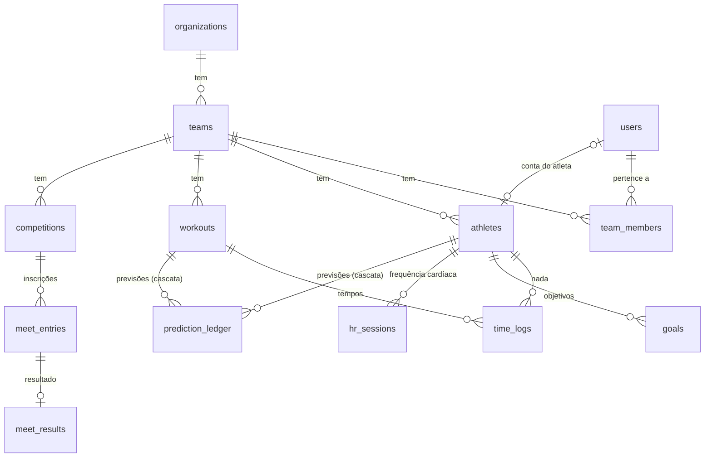

# Arquitetura

## Componentes

| Peça | Tecnologia | Onde corre | Papel |
|---|---|---|---|
| `apps/web` | Next.js 16, React 19, Tailwind 4 | Cloudflare Workers (OpenNext) em `aquastats.net` | UI, proxy `/api/v1/*` para a API (timeout 30 s / 120 s uploads), cabeçalhos de segurança, rate limit na edge |
| `apps/api` | FastAPI, SQLAlchemy 2, psycopg 3 | Cloud Run `aquastats-api` (europe-west3, máx. 3 instâncias) | Regras de negócio, autenticação, RLS, importação de provas |
| Base | PostgreSQL 18 (Neon) | eu-central-1 | Dados, RLS, ledger de previsões |
| `apps/ai-worker` | Cloudflare Worker + Workers AI | `workers.dev`, chave partilhada | Leitura de regulamentos/resultados em PDF |
| Modelo ML | TypeScript | No browser, num Web Worker | Previsões, qualidade dos dados, "o que cronometrar" |

## Pedido típico (cronometrar uma repetição)

```mermaid
sequenceDiagram
  participant T as Treinador (telemóvel)
  participant W as Worker (Next)
  participant A as API (FastAPI)
  participant D as Postgres
  T->>T: grava localmente (fila offline), debounce 500 ms
  T->>W: PUT /api/v1/times (Idempotency-Key, clientUpdatedAt)
  W->>A: proxy + X-Edge-Auth
  A->>D: aquastats_api: app.user_id → membership → app.team_id/app.role
  A->>D: INSERT … ON CONFLICT DO UPDATE WHERE edição mais recente
  D-->>A: linha guardada (ou a mais recente, "stale")
  A-->>T: tempo guardado; a célula mostra o valor do servidor
```

## Modelo de dados (principal)



Esquema completo: `apps/api/db/schema.sql` + migrações `apps/api/db/migrations/` (001–014). Tempos únicos por
(treino, bloco, atleta, repetição). O ledger é só de inserção; sai por cascata com o atleta, o treino ou a equipa.

## Isolamento

Duas roles na base (ver [security/rls.md](security/rls.md)): `aquastats_api` para tudo o que é de equipa (sem
BYPASSRLS; o atleta só vê o seu) e `aquastats_auth` só para os fluxos de autenticação. A API recusa arrancar em
produção com roles que contornem a RLS, e em desenvolvimento recusa a base de produção.

## Desempenho

- Snapshot da equipa: JSON dos tempos construído no Postgres, corpo escrito de uma vez, gzip; o site carrega os
  últimos 120 dias e o histórico antigo depois ([ADR 0003](adr/0003-snapshot-e-modelo-fora-do-main-thread.md)).
- No máximo 2 snapshots em construção por instância (o resto das escritas mantém CPU).
- O modelo corre num Web Worker; o ledger só grava com o histórico completo.

## Observabilidade

Logs JSON (uma linha por pedido: método, caminho, estado, ms, request id; nunca a query string), `/api/v1/health`
e `/api/v1/health/ready`. Alertas por métricas de logs no Cloud Monitoring: Fase G.
