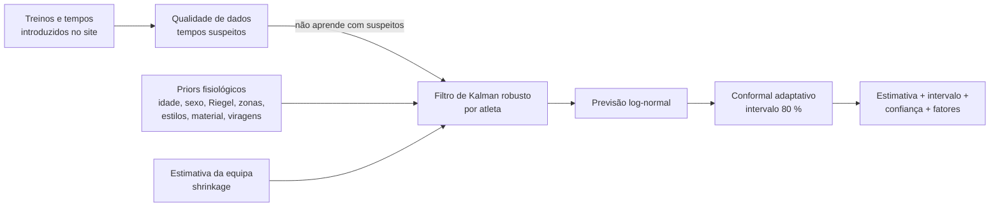
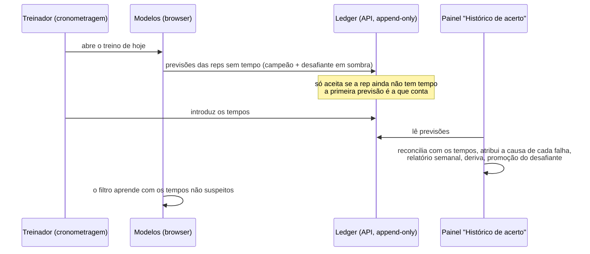

# ML card — previsão de treino da Aquastats

> **Resumo (EN).** A hierarchical state-space model that predicts every timed training rep of a
> swimmer (and how sure it is) from hand-entered data with gaps and typos. Physiology-based priors
> (Riegel / critical speed, 25↔50 m turns, strokes, gear, in-set fatigue, growth by age) are shrunk
> towards the team and corrected online by a robust Kalman filter with multi-scale form (session,
> day, level, return-from-break deficit). Intervals are calibrated with adaptive conformal
> prediction. Validated with a pre-registered chronological backtest on a physiology-based
> synthetic generator (8 scenarios × variants, 5 horizons, tuning/test seed split, paired
> bootstrap, leakage tests). On the same reps, day-ahead error drops from 1.65–1.89 % (current
> model) to 1.25–1.39 % (−0.27 to −0.62 pp, 95 % CI below zero in every scenario), 80 % intervals
> become calibrated (coverage error −6 to −25 pp), and 100 % of reps get a prediction (vs 21–77 %). A closed learning loop (append-only prediction ledger, reconciliation, error
> attribution, monitoring, champion/challenger in shadow mode) is built in; real-data results are
> pending because the production database has no logged times yet.

## 1. O que faz

Para cada repetição cronometrada (planeada ou já nadada) o modelo diz **quanto deve demorar**, um
**intervalo a 80 %**, uma **confiança** e os **2–3 fatores** que mais pesam (forma recente,
regresso de uma paragem, efeito do dia, cansaço na série, série nunca cronometrada). Aparece no
painel de treino (Análise › Treino), no novo painel **Histórico de acerto** e na página do treino
(**O que cronometrar**).

Restrições do domínio que guiaram o desenho:

- Tudo entra à mão por formulários: **faltam dados** (séries não cronometradas, sessões não
  registadas, bem-estar esporádico) e há **erros de digitação** (+1 min, dígitos trocados, parcial,
  tempos trocados entre atletas). A falta é informativa: cronometra-se mais o ritmo de prova.
- **Sazonalidade**: férias de agosto, regresso progressivo em setembro, atletas que voltam tarde.
- **Vários anos** e atletas em crescimento (juvenis/juniores).

## 2. Modelo



**Observação** (log-tempo de uma rep):

```
log t = estrutura(rep; β_atleta) + r(intensidade)·(L + e + R) + s + ε
```

- **Estrutura** — motor do atleta (100 m livres, piscina de 50, partida da água; prior por idade e
  sexo), expoente de Riegel, zonas (SUAVE…PA) como frações da velocidade crítica, ritmo de prova,
  estilos, material, viragens em piscina de 25, partida do bloco, fadiga dentro da série (posição ×
  descanso) e 1.ª rep. Cada fator começa na **estimativa da equipa** quando os colegas já o
  mostraram, senão no prior fisiológico — por isso uma série nova tem estimativa desde a 1.ª vez.
- **Forma multi-escala** — `s` sessão (reinicia a cada sessão), `e` dia (AR(1)), `L` nível
  (passeio aleatório com a deriva de crescimento esperada para a idade), `ν` tendência própria,
  `R` défice de regresso: depois de uma paragem salta `γ·h(dias)` (γ aprendido com o atleta e os
  colegas) e desaparece com a **carga treinada** registada — a rampa de setembro recupera-o aos
  poucos. `r(intensidade)`: a forma vê-se mais nas reps fortes do que nas aeróbias.
- **Aprendizagem online** — filtro de Kalman com pesos de Huber (um erro grosseiro mal mexe no
  estado), nível de ruído adaptativo, detetor CUSUM de mudança de regime (acelera a aprendizagem
  quando os erros insistem no mesmo sentido). Custo O(reps · 40²): anos de dados num passe.
- **Intervalos** — conformal adaptativo (Gibbs & Candès 2021) com erros normalizados pela
  incerteza do próprio modelo, estratificados pela quantidade de histórico e com um multiplicador
  por atleta separado para séries novas e conhecidas. A **confiança** vem da largura resultante.
- **Qualidade de dados** — um tempo é suspeito quando discorda das outras reps da mesma série (ou,
  sozinho, do histórico do atleta) muito para além do normal; o padrão de digitação que melhor o
  explica dá a sugestão de correção. Nada é apagado: só não entra no que o modelo aprende.

Código: `apps/web/src/lib/ml/` (`state-model.ts`, `forecaster.ts`, `quality.ts`,
`calibration.ts`, `production.ts`).

## 3. Validação

Protocolo **pré-registado** em [`protocolo.md`](protocolo.md) (fixado antes dos resultados; uma
alteração registada, antes dos resultados a que se aplica).

- **Gerador sintético** (`synthetic.ts`, v2.0) construído a partir da fisiologia e **de propósito
  diferente dos priors do modelo**: Riegel por troços, viragens em segundos que crescem em voltas
  lentas, fadiga por balanço de W′, três componentes impulso-resposta (fitness, fadiga, "sensação
  de água") com memória muscular, crescimento saturante por idade, choques diários AR(1), ruído de
  cauda pesada, cronometragem manual, erros de digitação reais e falta de dados informativa. Só
  campos que o site pede; IDs `syn-`; nunca misturado com dados reais.
- **Matriz**: 4 cenários base (6/12/26/40 semanas) + multi-ano (4 épocas) + regresso de agosto
  (curto/longo/tardio) × dados completos/em falta × metros baixo/base/alto × contexto
  nenhum/básico/carga/bem-estar.
- **Horizontes**: próxima rep, dia (principal), semana, mês, ano; sempre só com dados anteriores
  à origem. **Teste de fuga** automático: perturbar o futuro não pode mudar nenhuma previsão
  anterior (todos os modelos, todos os horizontes: 0 alterações).
- **Estatística**: sementes de ajuste (1–5) separadas das de teste (1001–1015); comparação
  emparelhada nas mesmas reps; IC 95 % por bootstrap das sementes.
- **Regra**: uma melhoria só fica se baixar o MAPE (IC < 0) em ≥ 3 de 4 cenários base, não piorar
  nenhum > 0,05 pp, não piorar CRPS nem calibração, e passar o teste de fuga.

## 4. Resultados (sintéticos, sementes de teste)

Fases pela ordem em que foram testadas (detalhe em [`results/`](results/)):

| Fase | Mudança | Veredicto | Efeito principal (horizonte dia, mesmas reps) |
|---|---|---|---|
| 1 | Qualidade de dados + conformal | **Mantida** | MAPE −0,07 a −0,26 pp; erro de calibração 80 % −6 a −25 pp |
| 2 | Modelo de estado hierárquico | **Mantida** | MAPE −0,20 a −0,36 pp; próxima rep −0,6 pp; 100 % das reps previstas |
| 3 | Contexto (manhã, 2.º treino, sono, ginásio) | Rejeitada | ≈ 0; só ajuda com bem-estar diário completo |
| 4 | Fitness–fadiga (Banister) nas reps | Rejeitada | +0,05 pp com poucos dados, neutro com muitos |
| 5 | Ensemble com pesos online | Rejeitada | +0,01 pp: o modelo de estado domina |
| 6 | Sazonalidade (pausa de agosto + "mesma altura do ano anterior") | Rejeitada pela regra | **ano: 3,36 % → 2,63 %**; mês: só 2 de 4 células significativas — decisão tua |
| (i) | Aprendizagem ativa: que série cronometrar | Positiva | −0,16 pp (esparso), −0,065 pp (típico) vs escolha ao acaso, mesmo orçamento |

Campeão final vs modelo atual, comparação direta e emparelhada nas mesmas reps (horizonte dia,
células de decisão, 15 sementes de teste — [`results/final-campeao-vs-atual.md`](results/final-campeao-vs-atual.md)):

| Cenário | Modelo atual | Campeão | ΔMAPE [IC 95 %] | ΔCRPS | Δ erro de calibração 80 % | Reps com previsão |
|---|---|---|---|---|---|---|
| Arranque (6 sem.) | 1,66 % | 1,39 % | −0,27 [−0,49; −0,10] | −0,36 pp | −24 pp | 21 % → 100 % |
| Esparso (12 sem.) | 1,65 % | 1,31 % | −0,34 [−0,47; −0,21] | −0,37 pp | −25 pp | 24 % → 100 % |
| Típico (26 sem.) | 1,89 % | 1,27 % | −0,62 [−0,70; −0,54] | −0,77 pp | −10 pp | 63 % → 100 % |
| Denso (40 sem.) | 1,80 % | 1,25 % | −0,54 [−0,61; −0,48] | −0,71 pp | −6 pp | 77 % → 100 % |

Oráculo (melhor previsão possível na véspera, só conhecida no sintético): ≈ 1,0 %.

**Regimes** (campeão vs mediana simples, horizonte dia): multi-ano 1,30 % vs 1,58 %; duas
primeiras semanas depois de agosto 1,16–1,30 % vs 1,64–1,87 %. **Curva de aprendizagem**: erro
~1,9 % nas semanas 2–3, ~1,55 % nas semanas 8–15, ~1,25 % a partir dos 4 meses, com cobertura
≈ 80 % sempre — é daqui que vem o aviso "a aprender" (< 8 semanas) na interface.

**Deteção de tempos suspeitos** (sementes de teste): precisão 92–100 %, recall 78–100 % (+1 min
100 %, dígitos trocados 96 %, trocas entre atletas 59 % — muitas vezes tempos quase iguais),
< 0,35 falsos alarmes por 1000 reps limpas, correção sugerida certa em 91–94 %.

## 5. Aprendizagem contínua



- **Ledger** — tabela `prediction_ledger` (migração 010): RLS por equipa, chave única por
  modelo/versão/horizonte/rep, trigger que recusa UPDATE/DELETE (testado em produção numa
  transação revertida). A API só grava uma previsão enquanto a rep não tem tempo.
- **Reconciliação** — emparelha previsão e tempo na leitura; um tempo corrigido volta a emparelhar.
- **Atribuição** — cada falha tem uma causa e o mecanismo que já a trata: erro de digitação (não
  aprende), dado em falta (incerteza já larga), regresso (reestima o défice), dia anormal (fica no
  efeito do dia), viés do atleta (CUSUM acelera), mal calibrado (conformal alarga), contexto.
- **Monitorização** — "o que aprendeu esta semana" (forma, défice de regresso, fatores que
  mudaram, mudanças de regime, tempos suspeitos), erro e cobertura por semana, alerta de deriva.
- **Campeão/desafiante** — o campeão (por omissão o modelo atual; `NEXT_PUBLIC_ML_CHAMPION=estado`
  troca) é o único mostrado; o outro corre em sombra e só deve substituí-lo quando ganhar nos dados
  reais: ≥ 200 reps em ≥ 6 semanas, ΔMAPE com IC < 0, CRPS e cobertura não piores.

**Arquitetura.** O modelo é TypeScript determinístico e corre onde estão os dados (o browser já
recebe a equipa inteira); o mesmo código corre no backtest. A API (Cloud Run, sem estado) só
guarda o ledger. O estado de cada atleta não é guardado: é reconstruído do histórico num passe
O(reps), por isso nunca fica desatualizado quando um tempo antigo é corrigido; se um dia for
lento, o caminho de escala é um checkpoint por atleta com hash dos dados de entrada.

## 6. Limitações (honestas)

- **Só validado em dados sintéticos.** A base de produção ainda não tem tempos; o gerador é uma
  hipótese sobre a realidade. O ledger existe para medir o modelo nos dados reais à medida que
  chegam — os números reais é que decidem a troca de campeão.
- **Com < 8 semanas de tempos** as estimativas ainda estão a assentar (a interface diz "a
  aprender" e mostra intervalos largos). Sem nenhum dado, os intervalos podem passar ±30 %.
- **Contexto** (sono, ginásio, turno) não melhorou as previsões com bem-estar esporádico; só é
  credível com bem-estar registado todos os dias.
- **Horizonte de um ano**: o campeão é fraco (3,4 %); a variante sazonal (2,6 %) não passou a
  regra por causa do horizonte mês.
- **Taper e carga A:C** na página da época são descritivos (parâmetros típicos; a evidência de que
  o ACWR prevê lesões é fraca).
- **Provas**: o modelo prevê reps de treino; ainda não prevê tempos de prova.

## 7. Reproduzir

```bash
cd apps/web
npm test                                                     # 38+ testes (harness, gerador, modelo, ledger, painel)
npx tsx scripts/ml-backtest.ts --cells all --save baseline-v2
npx tsx scripts/ml-backtest.ts --compare "modelo atual + qualidade + conformal" "modelo de estado + qualidade + conformal"
npx tsx scripts/ml-quality.ts --seeds test
npx tsx scripts/ml-active.ts --seeds test
```
