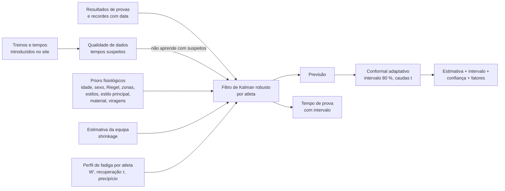
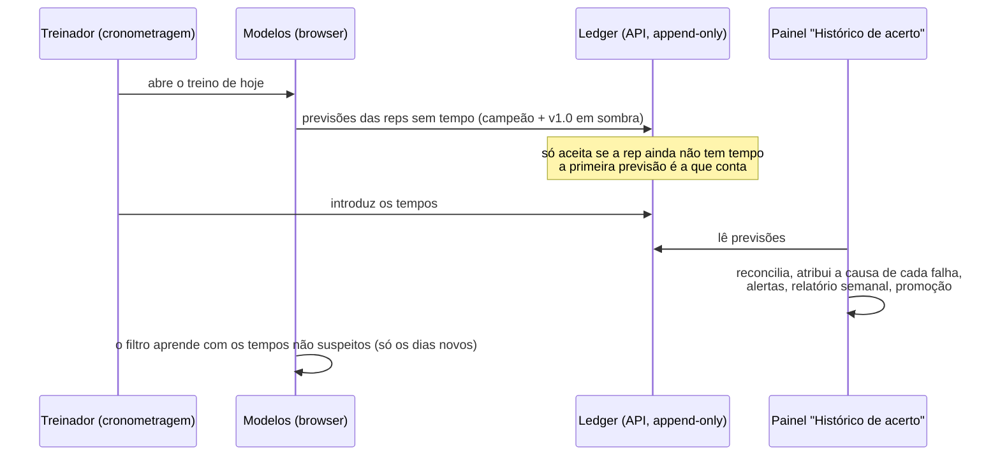

# ML card — previsão de treino e de provas da Aquastats (v1.0)

> **Summary (EN).** A hierarchical state-space model that predicts every timed training rep of a
> swimmer — and race times — with calibrated uncertainty, from hand-entered data with gaps and
> typos. Physiology-based priors (critical speed / Riegel, strokes and the athlete's main stroke,
> gear, turns, growth by age) are shrunk towards the team and corrected online by a robust Kalman
> filter with multi-scale form (session, day, level, return-from-break deficit); each athlete also
> has a Bayesian in-set fatigue profile (anaerobic reserve W′ and its recovery, with a "cliff"), and
> race results are observations of the same engine. Intervals: adaptive conformal prediction with
> Student-t tails. Developed under a pre-registered protocol on a physiology-based synthetic
> generator (tuning / development / single-use confirmation seeds, paired bootstrap, Bonferroni
> over a 15-experiment budget, leakage and property tests, stopping rule). **Validated on synthetic
> data only, now in shadow validation**: the production database has no logged times yet, and race-time
> estimates are not shown in the app. A closed learning loop
> (append-only prediction ledger, reconciliation, error attribution, health alerts,
> champion/challenger in shadow with a runtime kill switch) is in place to judge it on real data.

| | |
|---|---|
| Versão | **v1.0** (congelada: `apps/web/src/lib/ml/v1.ts`; teste "golden" `v1.test.ts`) |
| Estado na app | **Desafiante em sombra**: grava previsões, não é mostrado. O treinador continua a ver o modelo atual |
| Validação | **Validado em dados sintéticos, em validação em modo sombra** (gerador 3.0). Base de produção: 0 tempos (2026-10-05) |
| Registo de tentativas | [`experiments.md`](experiments.md) (todas, incluindo falhadas) |
| Protocolo | [`protocolo.md`](protocolo.md) (pré-registado, com adendas datadas antes dos resultados) |
| Monitorização | [`monitorizacao.md`](monitorizacao.md) · Dados que faltam: [`dados-necessarios.md`](dados-necessarios.md) · Correr: [`harness.md`](harness.md) |

## 1. O que faz

Para cada repetição cronometrada (planeada ou já nadada): **quanto deve demorar**, um **intervalo a
80 %**, uma **confiança** e os **2–3 fatores** que mais pesam (forma recente, regresso de uma
paragem, efeito do dia, cansaço na série, série nunca cronometrada). Para cada prova: o **tempo
esperado** na véspera ou semanas antes, com intervalo — validado só em sintético (E13; no arranque, a 28 dias, a
referência simples ganha) e **não mostrado na app**. Internamente também estima, por atleta, a
reserva anaeróbia W′ e a sua recuperação, e a probabilidade de uma série "quebrar" — estas duas
**não** aparecem na interface (validadas só em sintético; decisão do utilizador).

Não faz diagnóstico nem recomendações médicas: estima desempenho e carga.

## 2. Modelo



**Observação** (log-tempo de uma rep):

```
log t = estrutura(rep; β_atleta) + r(intensidade)·(L + e + R) + s + fadiga(série; W′, τ) + ε
```

- **Estrutura** — motor do atleta (100 m livres, piscina de 50, partida da água; prior por idade e
  sexo), expoente de Riegel, zonas como frações da velocidade crítica, ritmo de prova, estilos (com
  uma vantagem do **estilo principal** aprendida da equipa, E2), material, viragens em piscina de
  25, partida do bloco, 1.ª rep. Cada fator começa na estimativa da equipa (ou no prior fisiológico).
- **Provas como observações** (E3) — cada resultado é um esforço máximo da partida, com um fator
  "prova" aprendido da equipa: informa o motor do atleta e as reps de ritmo de prova.
- **Forma multi-escala** — `s` sessão, `e` dia (AR(1)), `L` nível (com o crescimento esperado
  para a idade), `ν` tendência, `R` défice de regresso que salta depois de uma paragem e desaparece
  com a carga treinada.
- **Fadiga dentro da série** (E12) — por atleta, uma posterior sobre (W′, τ) numa grelha: cada
  série é simulada (reserva gasta acima da velocidade crítica, recuperada no descanso); quando a
  reserva acaba a rep "cai do precipício". Aprende só com a **forma** de cada série; séries
  abandonadas contam como censuradas; cada dimensão evolui à sua velocidade. Monótona por
  construção: mais descanso ou menos reps nunca tornam uma série mais difícil. A sensibilidade ao
  volume foi retirada (não se aprende dos dados).
- **Aprendizagem online** — Kalman com pesos de Huber, ruído adaptativo, CUSUM de mudança de regime.
- **Intervalos** — conformal adaptativo (Gibbs & Candès 2021) normalizado pela incerteza do modelo,
  por quantidade de histórico, com multiplicador por atleta; distribuição Student-t (ν = 4, E6).
- **Qualidade de dados** — tempos que discordam da série ou do histórico muito além do normal
  são suspeitos (com o padrão de digitação provável como sugestão); não entram na aprendizagem.

Código: `apps/web/src/lib/ml/` — `state-model.ts`, `forecaster.ts`, `fatigue.ts`, `races.ts`,
`quality.ts`, `calibration.ts`, `pipeline.ts`, `production.ts`, `v1.ts`.

## 3. Protocolo

- **Gerador sintético** (`synthetic.ts` 3.0, congelado na fase final): atletas heterogéneos
  (velocidade crítica e W′ próprios, recuperação, efeitos de contexto com sinal individual, ~20 %
  atípicos), forma por impulso-resposta, pausa de agosto e regressos, provas, cronometragem manual,
  erros de digitação e falta de dados informativa. De propósito **"ligeiramente errado"** face aos
  priors do modelo. Hipóteses e riscos de Goodhart: [`experiments.md`](experiments.md) §2.6.
- **Horizontes**: próxima rep, dia (decide), semana, mês, ano. **Teste de fuga** automático em
  todos (perturbar o futuro não pode mudar nenhuma previsão anterior), incluindo provas e ledger.
- **Sementes**: ajuste 1–5 (desenho), desenvolvimento 3001–3015 (decide cada experiência),
  2001–2015 (tentativa única da fadiga), **confirmação 4001–4015 usada uma única vez**.
- **Regras** R1–R10: MAPE com IC < 0 em ≥ 3 de 4 cenários, nenhum pior > 0,05 pp, CRPS e
  calibração não piores, fuga 0, atípicos e subgrupos (sexo, escalão, estilo) não piores,
  heterogeneidade antes de rejeitar, e **Bonferroni** sobre um orçamento de 15 experiências.
- **Paragem**: dois pacotes seguidos sem ganho → congelar, confirmar uma vez, entregar.

## 4. Resultados por pacote (fase final; desenvolvimento 3001–3015, horizonte dia)

| Exp. | Pacote | Mudança | Resultado | Decisão |
|---|---|---|---|---|
| E1 | P3 | Riegel por troços | −0,010 pp no ajuste; CRPS pior | Abandonada no ajuste |
| **E2** | P3 | Estilo principal | −0,021 pp (Bonferroni −0,010) | **Aceite** |
| **E3** | P3 | Provas como observações | −0,054 pp, 4 de 4 cenários | **Aceite** |
| E4 | P1 | Erro da rep anterior na série (AR) | −0,005 pp no ajuste | Abandonada no ajuste |
| E5 | P1 | Variâncias re-estimadas | −0,009 pp no ajuste | Abandonada no ajuste |
| **E6** | P2 | Caudas Student-t | CRPS −0,006 pp, 4 de 4 | **Aceite** |
| E7 | P2 | Conformal por maturidade do atleta | CRPS +0,007 pp | Abandonada no ajuste |
| E8 | P4 | Contexto individual com sinal e atraso | −0,019/−0,053 pp com muitos dados, 0 nos outros | **Rejeitada** (R1) |
| E9 | P4 | Encolhimento local por fator | +0,025 pp | Abandonada no ajuste |
| E11 | P5 | Défice de regresso aprendido | ≈ 0; regresso já sem erro extra | Abandonada no ajuste |
| — | | **Paragem**: P4 e P5 sem ganho | | |
| **E12** | Fadiga | Fadiga individual com precipício (tentativa única, 2001–2015) | −0,092 pp; quebra melhor que a taxa da equipa em 4 de 4 | **Aceite** |
| **E13** | P6 | Tempos de prova | −0,19 pp vs melhor tempo anterior (véspera); cobertura 83 % | **Aceite** |

Antes da fase final (gerador 2.0 e 3.0): qualidade + conformal e modelo de estado aceites;
contexto, Banister, ensemble e sazonalidade rejeitados; fadiga individual v3-1 rejeitada (e, numa
segunda e única tentativa pré-registada, aceite como E12). Lista completa: [`experiments.md`](experiments.md).

### Confirmação do v1.0 (4001–4015, uma única vez)

Critérios pré-registados ([`experiments.md`](experiments.md) §2.4), contra o campeão antes da fase
final (estado 2.0), mesmas reps, horizonte dia — **passa** ([resultado](results/confirmacao-v1.md)):

| Cenário | estado 2.0 | **v1.0** | ΔMAPE [IC 95 %] | ΔCRPS | Cobertura 80 % |
|---|---|---|---|---|---|
| Arranque (6 sem.) | 3,15 % | **2,98 %** | −0,169 [−0,259; −0,087] | −0,164 pp | 77 % |
| Esparso (12 sem.) | 2,98 % | **2,76 %** | −0,221 [−0,343; −0,116] | −0,168 pp | 80 % |
| Típico (26 sem.) | 2,00 % | **1,85 %** | −0,146 [−0,193; −0,100] | −0,110 pp | 79 % |
| Denso (40 sem.) | 1,67 % | **1,56 %** | −0,106 [−0,134; −0,078] | −0,082 pp | 80 % |

Agregado −0,161 pp [−0,213; −0,113]; fuga 0; todos os subgrupos (sexo, escalão, estilo) melhoram.
Também melhora a semana (−0,10 a −0,23), o mês (−0,06 a −0,18), o ano (−0,06) e os regressos de
agosto (−0,10 a −0,12). **Exceção**: a próxima rep piora com poucos dados (arranque +0,07,
esparso +0,08 pp). Provas: na véspera −0,18 pp face ao melhor tempo anterior, cobertura 84 %.
Dados reais: **não avaliável** (0 tempos em produção).

**Face ao modelo que o treinador vê hoje** ("modelo atual"; sementes de desenvolvimento, nas reps
que ele consegue prever — [resultado](results/v1-vs-modelo-atual-dev.md)): arranque 1,98 → 1,56 %,
esparso 1,74 → 1,30 %, típico 2,11 → 1,42 %, denso 2,04 → 1,42 % (−0,42 a −0,69 pp; agregado
−0,54 pp), erro de calibração 5 a 25 pp menor, e o v1.0 prevê 100 % das reps (o atual 24–77 %).

### Onde está o erro que sobra

O oráculo (melhor previsão possível na véspera, conhecida só no sintético) fica em ≈ 1,0 %.
Com o gerador 3.0, **55 % do erro redutível** está em reps de um tipo que o atleta nunca nadou: a
parte individual de uma zona, estilo ou material novos é desconhecida até ser vista — nenhum
modelo a adivinha sem dados correlacionados (no gerador as características de cada atleta são
sorteadas de forma independente; testar uma matriz atleta × evento seria testar o gerador). Mais
21 % nas primeiras duas semanas de um atleta e 14 % nas quebras de série.

### Robustez e desempenho

- **Cadeia de degradação**: modelo de estado → mediana do grupo → último valor → "sem estimativa";
  nunca NaN nem exceção na interface. Determinístico; versão no ledger.
- **Incremental**: o estado (suspeitos, filtro, calibração) fica num ponto de controlo 2 dias
  antes do último dia cronometrado, com uma impressão digital dos dados; dados iguais → nada corre;
  dias novos → só os dias novos correm; um tempo antigo editado → passe completo. Retomar dá
  **exatamente** o mesmo que um passe completo (testado).

| Equipa | Reps | Passe completo | 1.º pedido na app | Mesmos dados | +1 dia novo |
|---|---|---|---|---|---|
| 8 atletas, 40 semanas | 7 510 | 0,27 s | 0,22 s | 11 ms | 0,07 s |
| 8 atletas, 4 épocas | 28 164 | 0,88 s | 0,99 s | 47 ms | 0,27 s |
| 20 atletas, 4 épocas | 59 768 | 1,98 s | 1,92 s | 99 ms | 0,56 s |
| 30 atletas, 4 épocas | 95 287 | 3,28 s | 3,25 s | 151 ms | 0,96 s |

  (~35 µs por rep num passe completo; memória retida ~37 MB por 95 mil previsões. Medido com
  `scripts/ml-perf.ts` num portátil; no browser conte com 1,5–3× mais. A deteção de suspeitos deixou
  de ser quadrática no tamanho da equipa: 2,2 s → 0,37 s com o mesmo resultado.)

- **Testes de propriedades**: mais descanso nunca torna uma série mais lenta; menos reps nunca a
  tornam mais difícil; invariância à ordem dos dados; determinismo; dados em falta (70 % apagados)
  sem NaN; um erro de +1 min é assinalado e mexe < 0,2 % no que vem a seguir; **sonda
  contrafactual**: um atleta que falha 4×50@50 hoje, dois meses depois completa 6×50@50
  (P(quebra) 0,02) mas continua a falhar 4×50@45 (0,99), sem nunca ter feito um 4×50@45.
- **Paridade**: em todas as experiências aceites nenhum subgrupo (sexo, escalão, estilo principal)
  piorou mais de 0,10 pp nem perdeu calibração (R10).
- **Interruptor**: `ML_CHAMPION` / `ML_SHADOW` lidos em tempo de execução (reversão imediata, sem
  build); **alertas** de cobertura, viés e deriva a partir do ledger no painel "Histórico de acerto".

## 5. Aprendizagem contínua



Promoção do v1.0 só com dados reais: ≥ 200 reps emparelhadas em ≥ 6 semanas, ΔMAPE com IC < 0,
CRPS e cobertura não piores. Reverter: alerta duas semanas seguidas ou desvantagem significativa.
Detalhe em [`monitorizacao.md`](monitorizacao.md).

## 6. Limitações

- **Validado só em sintético.** O gerador é uma hipótese sobre a realidade; onde o modelo usa a
  mesma forma funcional (lei de potência, impulso-resposta, W′), os ganhos são otimistas.
- **Não foi possível validar nada em dados reais**: 0 tempos na base de produção. O ledger
  (migração 010, ainda por aplicar) é o mecanismo para o fazer.
- **Só se aprende com mais dados**: os ganhos de contexto e de fadiga aparecem com meses de tempos
  (E8 e E12 ganham sobretudo em típico/denso). W′ precisa de ~30 séries por atleta; a recuperação
  τ aprende-se mal e a sensibilidade ao volume não se aprende — não são mostradas.
- **Um tipo de rep nunca nadado** fica com a incerteza da equipa até ser visto (a maior fatia do
  erro que sobra).
- **Provas**: no arranque, 28 dias antes, a referência simples ganha; poucas provas por época →
  intervalos de prova só estabilizam com dezenas de provas da equipa.
- **Horizonte de um ano**: as âncoras sazonais (3,36 % → 2,63 % na fase 6) estão prontas atrás de
  `ML_YEAR_ANCHORS`, mas a app ainda não tem previsões a um ano para gravar em sombra.
- **Desempenho**: com 30 atletas e 4 épocas, o primeiro pedido de uma sessão do browser faz um
  passe completo (~3 s); o estado incremental vive em memória (um reload volta a calcular).
- **Protocolo conservador**: componentes que só ganham com muitos dados falham a R1 (que exige
  ganho em 3 de 4 cenários, dois deles com poucos dados) — escolha deliberada.

## 7. Reproduzir

Ver [`harness.md`](harness.md). Em resumo:

```bash
cd apps/web
npm test
npx tsx scripts/ml-backtest.ts --compare "modelo de estado + qualidade + conformal" "v1.0 + qualidade + conformal" --seeds dev
npx tsx scripts/ml-races.ts --seeds dev
npx tsx scripts/ml-error-sources.ts
node --expose-gc --import tsx scripts/ml-perf.ts
```

## Gerador 4.0 — backtest de confirmação (2026-10-12)

Pré-registo: [`protocolo.md`](protocolo.md), adenda gerador 4.0. Uma única execução, sementes 6201–6215, horizonte
dia, v1.0.1 contra "último valor", gerador congelado (4.ª vez) antes de correr. Resultado completo:
[`results/confirmacao-gerador4.md`](results/confirmacao-gerador4.md).

| Célula | MAPE último valor | MAPE v1.0.1 | ΔMAPE [IC 95 %] | Cobertura 80 % |
|---|---|---|---|---|
| arranque | 1,52 % | 1,34 % | −0,179 [−0,201; −0,157] | 79,0 % |
| esparso | 1,44 % | 1,22 % | −0,215 [−0,233; −0,195] | 79,5 % |
| típico | 1,55 % | 1,36 % | −0,192 [−0,211; −0,169] | 79,5 % |
| denso | 1,56 % | 1,37 % | −0,187 [−0,207; −0,167] | 79,3 % |

- M1 ✓ (IC < 0 nas 4), M2 ✓ (cobertura 79,0–79,5 %), M3 ✓ (fuga 0). Todos os subgrupos (sexo, escalão, estilo) e
  atípicos melhoram; nenhum atleta piora com IC > 0.
- O "NÃO MANTER" do ficheiro vem das regras R3/R4 do protocolo de experiências (CRPS e calibração contra o campeão),
  que não se aplicam a um campeão sem intervalo ("último valor"). Os critérios desta adenda são M1–M3.
- **Não comparar com o gerador 3.0** (1,56–2,98 %): o MAPE mais baixo vem de dados completos sem erros de digitação
  e com muitas reps fáceis (aquecimento, A1) agora cronometradas, não de uma melhoria do modelo.
- Limite: tudo continua a ser sintético; em dados reais o v1.0.1 não foi avaliado (0 tempos reais).
