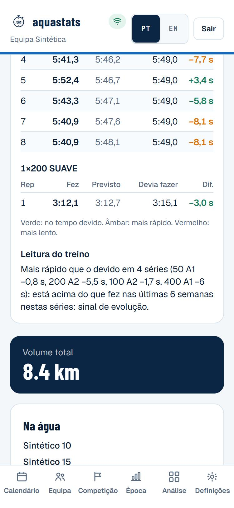
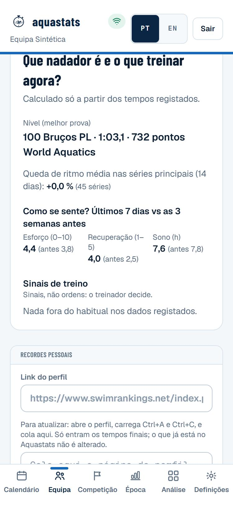

# Guia do treinador — como ler cada ecrã

Exemplos com a equipa **sintética** de demonstração (semente 9001, atletas "Sintético N"). Nenhum dado real.

## Treino › "Como correu o treino?"

- Escolhe o atleta no topo. Cada série tem as reps com **Fez** (o tempo registado), **Previsto** (o que o
  modelo esperava), **Devia fazer** (o tempo-alvo para aquela distância, zona, material e descanso, a partir
  das reps do próprio atleta nas últimas 6 semanas) e **Dif.** em segundos.
- Cores: verde no devido (dentro da variação normal do atleta), âmbar mais rápido, vermelho mais lento.
- **Leitura do treino**: frases curtas com o porquê. Ex.: "O rendimento caiu a partir da rep 6 nos 100 A2
  (+0,9 s/rep): a saída deu só 3 s de descanso. Para prevenir: mais 5 s de saída, ou 5 reps em vez de 8."
  "Mais rápido que o devido em 4 séries (…): está acima do que fez nas últimas 6 semanas: sinal de evolução."

*Não concluir*: falta de empenho por uma rep vermelha solta; olhar para a série inteira. O aquecimento e a volta
à calma (SUAVE) não entram nas frases.

## Atleta › "Que nadador é e o que treinar agora?"

- **Nível (melhor prova)**: a prova com mais pontos World Aquatics, o tempo e os pontos.
- **Queda de ritmo**: média da 2.ª metade das séries principais face à 1.ª, nos últimos 14 dias.
- **Como se sente?**: esforço, recuperação e sono dos últimos 7 dias contra as 3 semanas antes.
- **Sinais de treino**: cada um com dado, porquê, incerteza e alternativa. São sinais, não ordens.

## Atleta / Época › "Carga: como reage este atleta?"

A frase do topo diz como o atleta costuma reagir quando os km da semana sobem mais de 20 % face às 3 semanas
anteriores (todas com treino): se os tempos pioram na semana seguinte e se recuperam na 2.ª. Por baixo, uma
linha por semana: km, tempos face ao devido, esforço (0–10) e sono. Com menos de 2 subidas de carga nas últimas
12 semanas a frase diz que ainda não há dados. *Não concluir*: risco de lesão; descreve a resposta aos tempos.

## Análise › Prova › "Porque correu assim?"

- 3–5 frases no topo: contra o recorde pessoal, o polimento, os treinos antes da prova, o perfil, o sono.
- **Contra o recorde pessoal**: total e, quando há parciais nas duas provas, reação e cada segmento (verde
  ganhou tempo, vermelho perdeu). Primeiro parcial mais rápido e último mais lento que no recorde = abertura
  rápida demais.
- **O polimento resultou?**: redução do volume das 2 semanas antes face às 4 anteriores — pouca (< 30 %),
  adequada (30–65 %) ou demasiada (> 65 %; Bosquet 2007: ótimo 41–60 %) — e a parte de A3 e ritmo de prova.
- **Perfil**: 25/50 melhores e séries longas piores = mais potência, menos resistência; o contrário = falta
  velocidade.

## Época › "A distribuição de zonas está certa para a fase?"

% do volume da equipa nas últimas 4 semanas por zona contra uma referência indicativa da fase do plano.
*Não concluir*: que fora do intervalo é um erro; os intervalos vêm da prática, não de estudos verificados.

## Regras gerais de leitura

- Diferenças abaixo da variação normal do atleta (mínimo 0,5 % do tempo) não aparecem (Pyne 2004).
- A carga descreve a semana; não é risco de lesão.
- O taper vale em média 1–3 %, com grande variação entre atletas; não é uma garantia.
