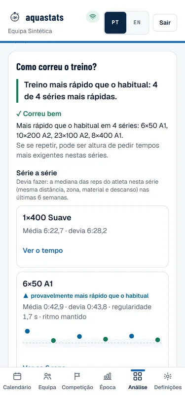
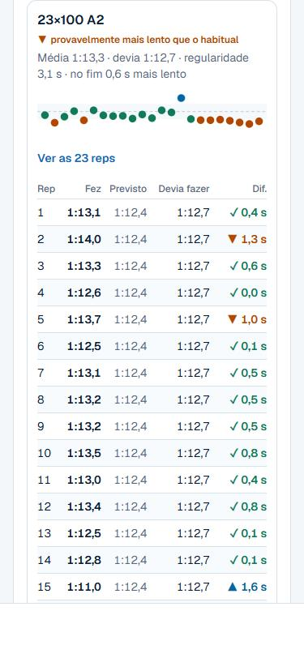
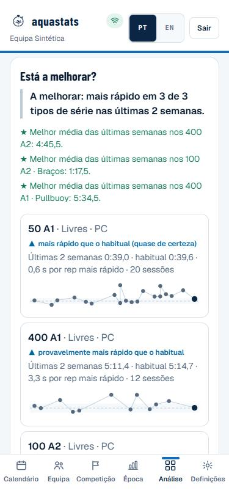
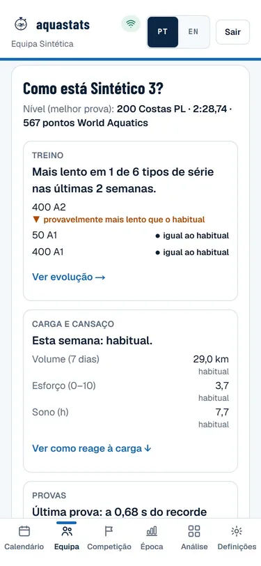
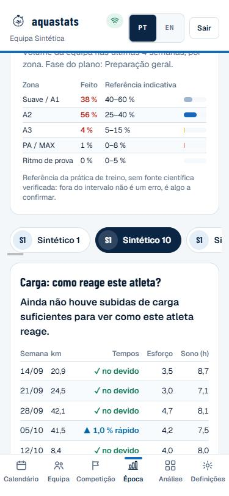
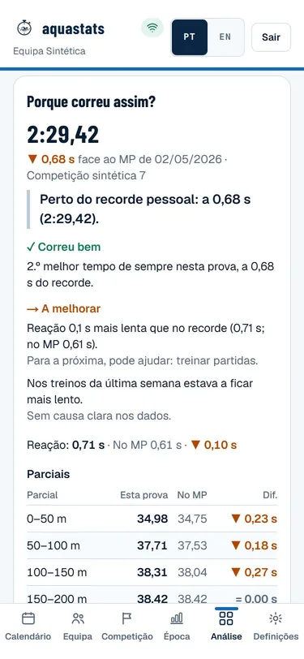

# Guia do treinador — como ler cada ecrã

Exemplos com a equipa **sintética** de demonstração (semente 9001, atletas "Sintético N"). Nenhum dado real.
Porque é assim: [`benchmark-visualizacao.md`](benchmark-visualizacao.md).

## A mesma linguagem em toda a app

- **Primeiro a conclusão, numa frase.** Depois **✓ Correu bem** e **→ A melhorar** (no máximo 3 pontos,
  primeiro o que correu bem). Por fim, os números.
- **Cada atleta é comparado consigo próprio**, com a sua variação normal na mesma série (mesma distância,
  zona, material e descanso), e nunca com uma regra igual para todos.
- **Certeza em palavras:**
  - ▲ **mais rápido** (azul) / ▼ **mais lento** (laranja), com "provavelmente" ou "quase de certeza";
  - ● **igual ao habitual**;
  - ○ **ainda não dá para dizer**, sempre com a razão: "poucas vezes feita" ou "os tempos variam muito".
- **Cada rep** fica ▲ mais rápida, ✓ no tempo ou ▼ mais lenta face ao "devia fazer". A cor nunca aparece sem
  o ícone e a palavra.
- **Causas como "coincide com"**, só o que estava fora do normal do atleta (por exemplo "dormiu 5 h
  (costuma 8 h)"). Nunca um diagnóstico. "Uma sessão não é tendência."
- **Tempos com vírgula:** treino com décimas (1:13,3) e provas com centésimas (1:04,36).

## Treino › "Como correu o treino?"

- **Fichas de atleta com o estado do dia:**
  - ✓ ao nível ou acima do habitual;
  - ● misto;
  - ▼ abaixo do habitual ou com quebra;
  - ○ ainda não dá para dizer.
- **A frase de abertura resume o treino.** Por exemplo: "Quase tudo ao nível habitual: 1 de 4 séries
  abaixo."
- **"A melhorar"** diz o quê, com o número; o que coincidiu; e uma opção para a próxima. Exemplos:
  - "Quebrou a partir da rep 6 nos 8×100 A2: +0,9 s por rep até ao fim. Coincide com: saída com só 3 s de
    descanso. Para a próxima, pode ajudar: mais 5 s de saída, ou 5 reps em vez de 8."
  - "Mais lento que o habitual nos 23×100 A2: +0,6 s por rep (provavelmente). Coincide com: semana com
    26 % mais metros que as 3 anteriores. Uma sessão não é tendência: ver a próxima antes de mudar o
    plano."

- **Série a série**, cada uma num cartão:
  - média, "devia fazer", regularidade (melhor–pior) e o fim da série face ao início;
  - uma fila de pontos (uma rep por ponto, mais rápido em cima) sobre a faixa do normal do atleta;
  - em **"Ver as N reps"**: Fez / Previsto / Devia fazer / Dif.
- **O aquecimento e a volta à calma (SUAVE)** aparecem, mas não são julgados.
- *Não concluir* falta de empenho por uma rep laranja solta. Lê-se a série inteira.

## Análise › Treino

- **Sessão:** o mesmo relatório para qualquer dia do calendário.
- **Evolução — "Está a melhorar?":** por tipo de série, as últimas 2 semanas contra as 6 anteriores.
  - Mostra a média de cada sessão, a faixa do habitual e o veredito.
  - ★ marca a melhor média recente numa série.
  - "Depois das paragens" diz quanto tempo levou a voltar ao nível.

## Atleta › "Como está …?"

Três cartões, cada um com uma ligação para o detalhe:
- **Treino:** a evolução por tipo de série.
- **Carga e cansaço:** volume, esforço e sono dos últimos 7 dias face às 4 semanas antes, em palavras
  ("acima do habitual").
- **Provas:** a última prova face ao recorde pessoal.

Por baixo: o nível (melhor prova e pontos World Aquatics) e, no máximo, 3 sinais de treino.

## Atleta / Época › "Carga: como reage este atleta?"

- **A frase do topo** diz o que costuma acontecer aos tempos quando os km sobem mais de 20 % face às 3
  semanas anteriores (todas com treino).
- **A tabela tem uma linha por semana:** km, tempos face ao devido, esforço e sono.
- **Regressos depois de uma paragem** não contam como subida de carga.
- *Não concluir* risco de lesão.

## Análise › Prova › "Porque correu assim?"

- **Cabeçalho:** o tempo, a etiqueta MP se for recorde pessoal, e a diferença ao MP com data e competição.
- **Correu bem / A melhorar.** Exemplos:
  - "Perdeu 0,72 s na 2.ª metade face ao recorde. Para a próxima: trabalhar a 2.ª metade."
  - "Passou aos 50 m 0,5 s mais rápido que no recorde e perdeu 1,1 s na 2.ª metade: a prova decidiu-se no
    ritmo." Neste caso sugere a passagem do recorde como referência.
- **Reação:** a desta prova e a do MP. Entra em "A melhorar" só se for 0,1 s ou mais lenta.
- **Parciais:** cada parcial com o do MP e a diferença (▲ ▼, e "=" abaixo de 0,1 s). Por baixo, o ritmo de
  prova num número: 2.ª metade menos a 1.ª.
- **Preparação (só o treinador vê):**
  - polimento adequado (redução de 30–65 % do volume), curto ou excessivo;
  - proporção de trabalho rápido (só é alerta se cair para menos de metade);
  - treinos e perfil nas 2 semanas antes;
  - sono, recuperação e ginásio.

## O que vê o atleta

O atleta vê o mesmo, mas escrito para ele:
- no máximo um ponto forte e um foco ("Foco para a próxima: …");
- comparação só consigo próprio;
- sem crítica do polimento nem da carga;
- o histórico mostra a série principal de cada treino, nunca um "melhor tempo" que mistura distâncias.

## Regras gerais de leitura

- Uma diferença dentro da variação normal do atleta não é sinal (Pyne 2004; Hopkins).
- A carga descreve a semana; não é risco de lesão.
- O polimento vale em média 1–3 %, com grande variação entre atletas; não é uma garantia.
