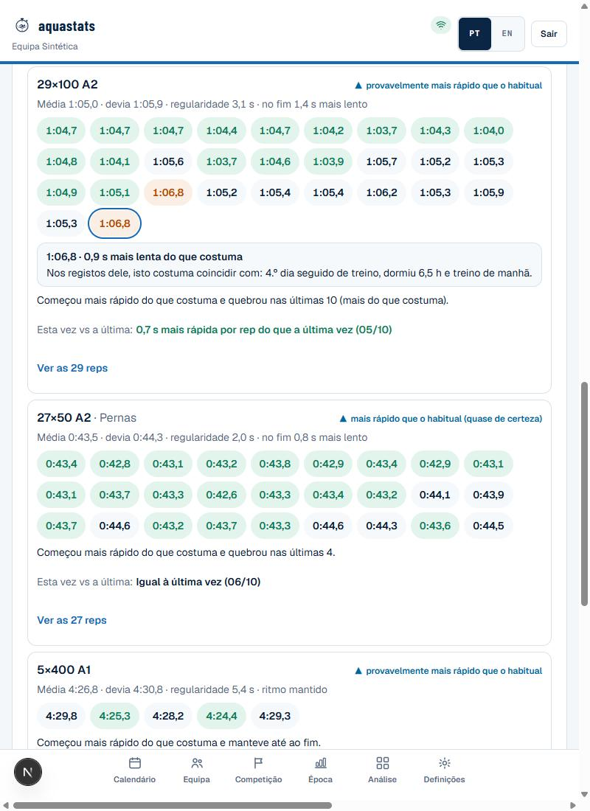
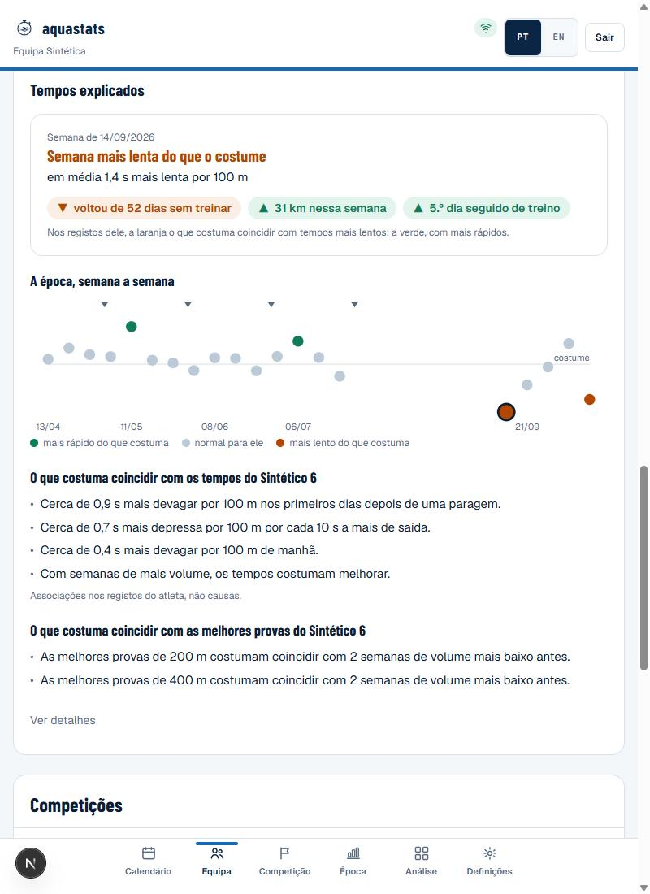
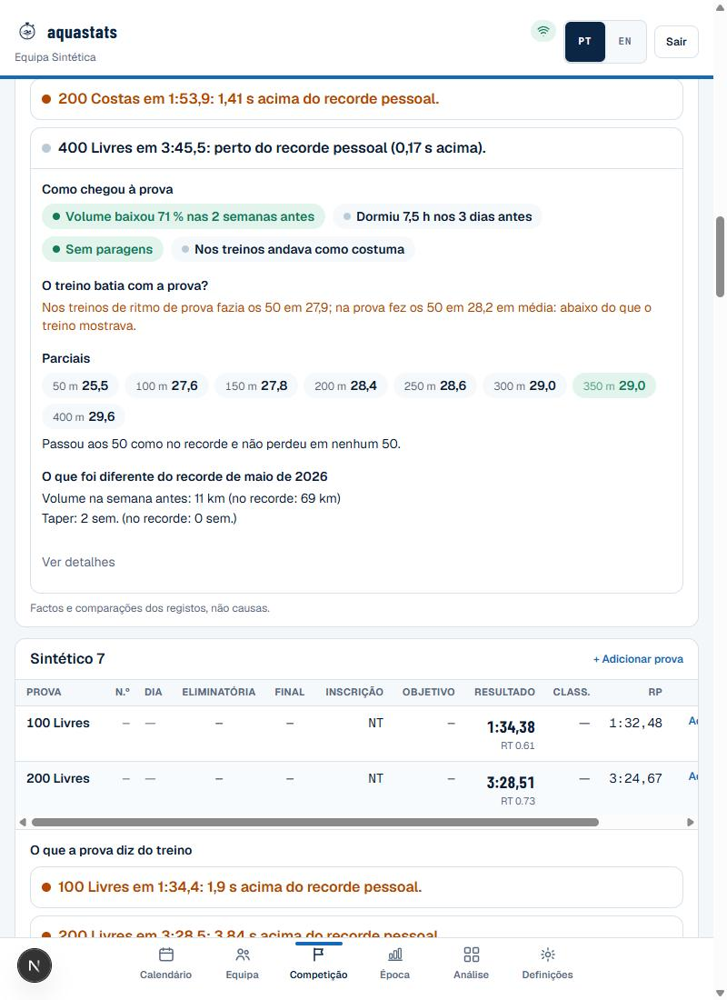

# Tempos explicados — treino e competição

Responde às três perguntas que o treinador faz depois de cada treino e de cada prova:

1. **Porque é que esta rep, este treino ou esta semana saíram assim?**
2. **O que foi diferente desta vez?**
3. **O que diz a prova sobre o treino que a preparou?**

A resposta aparece onde o treinador já está (no treino, no perfil do atleta e na página da competição), e não numa
página de análise à parte. Está escrita em palavras de treinador, sem exigir conhecimentos de estatística.

Regras técnicas e limiares: [`indicadores.md`](indicadores.md#tempos-explicados-treino-e-perfil-do-atleta-treinador).
Como ler cada ecrã: [`guia-do-treinador.md`](guia-do-treinador.md).

---

## 1. Princípios de desenho

| Princípio | Na prática |
|---|---|
| **Cada atleta comparado consigo próprio** | "Costuma" é o habitual do atleta naquele tipo de rep: mesma piscina, distância, estilo, intensidade e material. É a mediana ponderada das reps anteriores, com meia-vida de 28 dias. Nunca há uma regra igual para todos |
| **Três estados, sempre com palavra** | Verde **mais rápido do que costuma**, cinzento **normal para ele/ela**, laranja **mais lento do que costuma**. A cor nunca aparece sozinha |
| **O normal não se explica** | Diferenças abaixo de 1 % (`NOISE_PCT`) são ruído de medição e de dia a dia. O ecrã diz "dentro do habitual, nada a explicar" |
| **Associação, nunca causa** | Sempre "nos registos dele/dela, isto costuma coincidir com…", porque a parte de contexto do modelo não passou no backtest (ver [`../ml/modelo-atual.md`](../ml/modelo-atual.md)). Nunca "foi por causa de" |
| **Poucos motivos e controláveis** | No máximo 3, e só os que o treinador entende e pode mudar: paragem, sono, dias seguidos, volume, manhã, ginásio, saída. O dia da semana nunca aparece como motivo |
| **Segundos e palavras primeiro** | "Dormiu 6 h (antes 8 h)", "1,9 s mais rápida do que costuma". As percentagens, as margens e o número de reps ficam em **Ver detalhes** |
| **Sem prescrições** | O ecrã descreve o que aconteceu e não diz ao treinador o que fazer |
| **Dado em falta, dito** | Sem sono ou RPE registados, o ecrã diz "não registado" em vez de inventar uma explicação |

## 2. O que o treinador vê

### 2.1 No treino (cada série)



- **Cada tempo é um chip colorido.** Ao tocar, ou ao passar o rato, abre uma caixa:
  "1:06,8 · 0,9 s mais lenta do que costuma. Nos registos dele, isto costuma coincidir com: 4.º dia seguido de
  treino e dormiu 6,5 h."
- **A curva da série numa frase:** "Começou como costuma e quebrou nas últimas 2 (mais do que costuma)."
- **Esta vez vs a última:** a diferença média por rep face à última vez que fez a mesma série, com até 3 linhas do
  que foi diferente (sono, dias seguidos, RPE, volume, saída).
- **Resumo no topo do treino:** uma linha, por exemplo "3 reps mais lentas do que costuma, quase todas no fim das
  séries; 4.º dia seguido de treino".

### 2.2 No perfil do atleta



- **Cartão da semana:** "Semana mais lenta do que o costume", com a média em s por 100 m e os motivos em etiquetas
  (laranja os que costumam coincidir com tempos mais lentos, verde com mais rápidos).
- **A época, semana a semana:** uma bola por semana nos três estados, com as provas marcadas. Tocar numa semana abre
  o cartão dessa semana.
- **O que costuma coincidir com os tempos dele:** até 4 frases curtas, só para associações fora da margem, por
  exemplo "Cerca de 0,4 s mais devagar por 100 m de manhã."
- **O que costuma coincidir com as melhores provas:** só com 6 ou mais provas da mesma distância.

### 2.3 Na competição: o que a prova diz do treino



Uma linha por prova nadada, que se abre ao tocar. Mostra só factos e comparações, sem estatística.

| Parte | Pergunta a que responde | Exemplo |
|---|---|---|
| **Resultado** | Como correu face ao recorde pessoal? | "400 Livres em 3:45,5: perto do recorde pessoal (0,17 s acima)." |
| **Como chegou à prova** | Que preparação teve nas 3 semanas antes? | Etiquetas: "Volume baixou 71 % nas 2 semanas antes", "Dormiu 7,5 h nos 3 dias antes", "Sem paragens", "Nos treinos andava como costuma" |
| **O treino batia com a prova?** | Nadou o que o treino mostrava? | "Nos treinos de ritmo de prova fazia os 50 em 27,9; na prova fez os 50 em 28,2 em média: abaixo do que o treino mostrava." |
| **Parciais** | Onde ganhou ou perdeu face ao recorde? | Os 50 como chips coloridos e "Passou aos 50 como no recorde e não perdeu em nenhum 50." |
| **O que foi diferente do recorde** | Em que diferiu a preparação da melhor prova? | "Volume na semana antes: 11 km (no recorde: 69 km)" |

> **Limite:** "O treino batia com a prova?" compara a média por 50 da prova com as séries de ritmo de prova das 4
> semanas antes. A comparação só é justa se essas séries forem mesmo ao ritmo da prova em causa. Sem séries
> comparáveis, o ecrã diz que não as encontrou.

## 3. Como funciona

```
time_logs ──► explainTrainingTargets (modelo v1.0, sem alterações)
                 │  nível habitual por grupo + peso de cada fator de contexto
                 ▼
          explained-times.ts ──► 3 estados · motivos (≥ 8 reps, peso ≥ 0,2 %) · frases do perfil
                 │
meet_results ─► race-story.ts ──► resultado · como chegou · treino vs prova · parciais · vs a melhor
```

| Módulo | Responsabilidade | Testes |
|---|---|---|
| `apps/web/src/lib/training-prediction.ts` (`explainTrainingTargets`) | Expõe a decomposição que o modelo v1.0 já calculava, sem a mudar (o teste golden do v1.0 continua a passar) | `v1.test.ts` |
| `apps/web/src/lib/explained-times.ts` | Estados, motivos, curva da série, "vs a última", cartão da semana, época e frases do perfil | `explained-times.test.ts` (a soma dos pesos com o resto bate com o tempo real) |
| `apps/web/src/lib/race-story.ts` | As 5 partes da prova e as frases de competição do perfil | `race-story.test.ts` |
| `components/analise/tempos-reps.tsx`, `tempos-explicados.tsx` | Chips, caixa e cartões, acessíveis por teclado e toque (`aria-live`), com a tabela alternativa em **Ver detalhes** | Demo sintética (capturas) |
| `components/competicoes/race-story.tsx` | Linha da prova, que se abre ao tocar | Demo sintética (capturas) |

Tudo é calculado no browser, a partir dos dados que a API já devolve. Não há endpoints nem migrações novos.

## 4. Limites conhecidos

- **São associações e não causas.** Com poucos dados, os motivos podem mudar de semana para semana.
- **Dependem do registo.** Sem sono, RPE ou ginásio registados, ficam menos motivos.
- **A competição tem pouca amostra.** Um atleta nada poucas provas por época, por isso as frases de competição no
  perfil só aparecem com 6 ou mais provas da mesma distância.
- **Ainda não foi validado com dados reais.** O desenho foi verificado na demo sintética (semente 9001). Falta
  confirmar com um clube real se os motivos coincidem com o que o treinador vê na piscina.

## 5. Verificação

`npx tsc --noEmit`, `npx eslint`, `npm test` (137 testes) e `npx opennextjs-cloudflare build`, todos a partir de
`apps/web`. Capturas da demo sintética em `docs/img/tempos-*.jpg`. PR #41.
